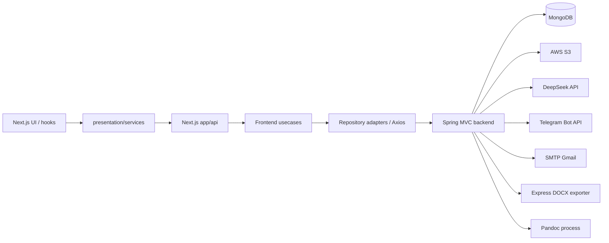
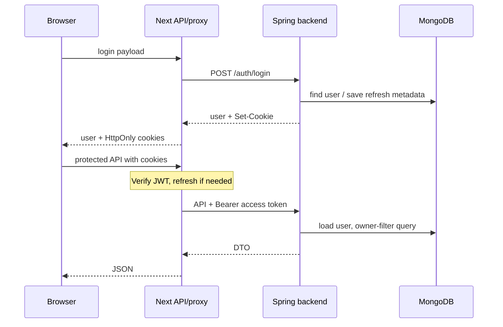

# Kiến trúc WEdu hiện tại

## Đọc hàng chờ câu hỏi — 2026-10-27

Ranh giới phân trang: `IQuestionRepository.findPending`/adapter chỉ trả `List<QuestionEntity>`; `countPending` trả long. Cả hai dùng chung private `pendingQuery` để giữ bộ lọc nhất quán. `QuestionService.findPending` ở tầng usecase điều phối count/list, chuyển entity qua mapper và tạo `PendingQuestionPageDTO` với metadata phân trang. Không wrapper entity/DTO phân trang trong infrastructure; đã xóa QuestionPageEntity. HTTP contract giữ nguyên.

Frontend review đã nối theo component → hook → presentation service → Next BFF → usecase → port/adapter → backend moderator. ModeratorController giữ mỏng, ModeratorUsecase validate page/filter và điều phối ChapterService.getAll, QuestionService.findPending, S3Service.generatePresignedUrl. Query/count/skip/limit nằm trong question repository; dữ liệu liên feature là common DTO, không expose entity. QuestionDTOMapper tạo DTO độc lập để việc ký ảnh không ghi vào persistence. Search chương/bài xác định IDs từ danh mục, OR với template rồi phân trang Questions; không join/import model từ questionReview. Không đổi schema hoặc ranh giới importer/exam generation. [Contract](api-reference.md), [wiring](module-map.md).

## Collection câu hỏi cần duyệt — 2026-10-26

questionReview có entity/document snapshot và Content/Variables nội bộ; không import model hoặc mapper từ question. QuestionReviewMapper componentModel=spring tự ánh xạ nested models. Luồng vẫn QuestionService.generateExamQuestions (@Transactional) → lưu Questions → QuestionReviewService → QuestionReviewUsecase → IQuestionReviewRepository → QuestionReviewRepositoryImpl → QuestionsReview. Liên module chỉ truyền List<String> IDs tới service; transaction/schema fields/API giữ nguyên. Collection name QuestionsReview theo chỉnh sửa source hiện tại; không đổi lại QuestionsToReview.

Bằng chứng: [QuestionReviewDocument](../backend/src/main/java/com/wedu/exam_creation/questionReview/infrastructure/document/QuestionReviewDocument.java), [RegeneratedQuestionEntity](../backend/src/main/java/com/wedu/exam_creation/questionReview/domain/entity/RegeneratedQuestionEntity.java), [RegeneratedQuestionDocument](../backend/src/main/java/com/wedu/exam_creation/questionReview/infrastructure/document/RegeneratedQuestionDocument.java), [QuestionReviewMapper](../backend/src/main/java/com/wedu/exam_creation/questionReview/infrastructure/mapper/QuestionReviewMapper.java).

## Trạng thái câu hỏi — 2026-10-26

QuestionService quyết định trạng thái ban đầu trước persistence: public insertFromDocx cho parse gán APPROVED; nhánh AI gọi method private với PENDING_REVIEW. QuestionEntity ↔ QuestionMapper ↔ QuestionDocument giữ String status. Không đổi ranh giới service, HTTP DTO hoặc quyền; không lọc status khi sinh đề.

Bằng chứng: [QuestionService](../backend/src/main/java/com/wedu/exam_creation/question/usecase/QuestionService.java), [QuestionDocument](../backend/src/main/java/com/wedu/exam_creation/question/infrastructure/document/QuestionDocument.java).

## Kiểm duyệt S3 — cập nhật 2026-10-25

Frontend giữ ranh giới component → hook → service → Next BFF → usecase → repository/adapter. Backend ModeratorController mỏng; [ModeratorUsecase](../backend/src/main/java/com/wedu/exam_creation/moderator/usecase/ModeratorUsecase.java) điều phối storage/import/mail. StoredDocumentFile bọc bytes S3 thành MultipartFile, validateDocumentFile dùng chung với upload. Bản chỉnh sửa chỉ tồn tại trong request, không persist S3; subject lấy từ key gốc. Importer/Pandoc không thay đổi.

Approve import xong mới xóa gốc; trả fileDeleted=false khi chỉ bước xóa lỗi. Reject validate email/lý do, xác nhận tồn tại, xóa rồi gửi email text/plain một lần; mail lỗi chỉ log loại exception, không Telegram/retry. Không transaction phân tán hoặc trạng thái moderation bền vững; UI chỉ giữ cleanupKeys trong phiên hiện tại, không chống race/restart/mất phản hồi. Preview sandbox dùng chung cho bản gốc và File cục bộ.

[API](api-reference.md#duyệttừ-chối-tệp--2026-10-25), [validation](current-status.md#kiểm-duyệt-tệp-s3--2026-10-25). Các nhận định list/parse độc lập trong snapshot cũ bên dưới được thay thế bởi phần này; thiếu persisted audit vẫn giữ.

Khảo sát source, manifest và configuration trong working tree ngày 2026-10-24, gồm cả thay đổi chưa commit. Phiên bản dưới đây là khai báo dependency, không xác nhận môi trường triển khai. Không đọc nội dung `.env`; không chạy build/test hoặc gọi dịch vụ ngoài trong lần cập nhật tài liệu này.

## Đọc cùng bộ context

Refactor frontend 2026-10-25: [QuestionFilesPage](../frontend/app/(site)/moderator/question-files/page.tsx) chỉ render dữ liệu/props từ [useQuestionFiles](../frontend/presentation/hooks/Moderator/useQuestionFiles.ts). Hook giữ auth, query/mutation, state/ref chống gửi lặp, xử lý lỗi/thông báo, cache/refetch và định dạng dung lượng/thời gian; giao tiếp ModeratorService theo luồng phân lớp hiện có. Native dialog giữ logic focus/Escape riêng của component. Không đổi API, query key, quyền hoặc luồng xóa.

Cập nhật 2026-10-25: xóa question file dùng DELETE qua BFF/port/adapter hiện có; backend moderator usecase giới hạn key trước khi gọi `S3Service.deleteFile`, giữ storage là ranh giới AWS. Chỉ xóa object hiện tại bằng DeleteObject; không purge version history hoặc xóa câu hỏi đã import. UI chỉ cập nhật cache sau khi DELETE thành công, sau đó refetch danh sách. [API](api-reference.md), [usecase](../backend/src/main/java/com/wedu/exam_creation/moderator/usecase/ModeratorUsecase.java), [UI](../frontend/app/(site)/moderator/question-files/page.tsx).

[Tech stack](tech-stack.md): dependencies/lệnh/config. [Module map](module-map.md): controllers, usecases, ports/adapters, DTO/models và HTTP endpoints. [Business flows](business-flows.md): nghiệp vụ/auth/review/giao dịch. [Database schema](database-schema.md): document fields/references/states. [Current status](current-status.md): định nghĩa implemented/partial/missing/unknown và phân loại feature. Các mô tả bên dưới có nguồn đối chiếu tại mục Bằng chứng cuối file.

## 1. Module và tech stack

| Module | Công nghệ từ manifest/configuration |
| --- | --- |
| `frontend/` | Next.js `^16.1.6`, React/React DOM `19.2.3`, TypeScript `^5`, TanStack React Query `^5.90.21`, Axios `^1.13.2`, Tailwind CSS `^4` qua PostCSS, JOSE `^6.2.3`, KaTeX `^0.16.32`. Framer Motion, Lucide và DOMPurify cũng nằm trong dependencies. |
| `backend/` | Java 17, Spring Boot `4.0.6`, Spring MVC, Security/OAuth2 Client, Data MongoDB, Mail, JJWT `0.13.0`, AWS SDK S3 `2.46.16`, Tika `3.3.1`, MapStruct `1.6.3`, Lombok, Springdoc OpenAPI `3.0.3`. Maven wrapper trỏ Maven `3.9.14`. |
| `exporter-service/` | Express `^5.2.1`, TypeScript `^6.0.3`, tsx `^4.23.0`, docx `^9.7.1`, JSZip `^3.10.1`, MathJax Full `^3.2.1`, mathml2omml `^0.5.0`, image-size `^2.0.2`. ESM, `NodeNext`, strict TypeScript. |

Zod được import trong frontend schema/API; lockfile chứa `4.3.2` qua dependency gián tiếp, nhưng manifest chưa khai báo trực tiếp. Hai manifest npm không cố định Node runtime; `@types/node` không xác định runtime.

Nguồn: `frontend/package.json`, `frontend/package-lock.json`, các config TypeScript/ESLint/PostCSS; `backend/pom.xml`, `.mvn/wrapper/maven-wrapper.properties`; `exporter-service/package.json`, `tsconfig.json`.

## 2. Luồng tổng thể

Ba module có build riêng, không có root workspace script. Frontend dev/start dùng cổng 3000; exporter cố định 8000, JSON limit 50 MB. Docker backend expose 8080, build JAR với `-DskipTests`, runtime Java 17 chạy bằng user riêng. `application.yml` không ghi đè server port.

## 3. Backend và quan hệ feature

Root package là `com.wedu.exam_creation`; Maven group hiện là `com.wedu` theo [pom.xml](../backend/pom.xml). Kiến trúc phân lớp theo feature, dùng repository interfaces/adapters; không phải mọi feature có đủ các lớp.

- `controller`: HTTP binding/principal, gọi use case/service.
- `usecase`: nghiệp vụ, phối hợp các feature; một số `*Service` là facade liên feature.
- `domain/entity`, `domain/repository`: entity và repository contract; draft có thêm `domain/payload`.
- `infrastructure/document`, `mapper`, `repository`: Mongo document, MapStruct và MongoTemplate.
- `dto/request`, `dto/response`, `dto/mapper`: contract feature; `common/dto` dùng liên feature.
- `common/exception/GlobalExceptionHandler`: phần lớn lỗi trả `{message}` cùng status; bean validation trả map theo field. JWT filter tự tạo error response.

Constructor injection phổ biến; MapStruct dùng `componentModel = "spring"`, annotation processors nằm trong Maven; Lombok tạo accessor/constructor. Có chỗ inject implementation cụ thể như refresh-token service, nên không mô tả đây là Clean Architecture tuyệt đối hoặc tự đổi dependency ngoài phạm vi.

| Feature | Vai trò và dependency |
| --- | --- |
| `auth`, `security` | Đăng ký/đăng nhập/đổi mật khẩu, JWT, Google OAuth2; dùng user, refreshToken, passwordResetToken. |
| `user`, `admin` | Profile/avatar và role/khóa/xóa tài khoản; phối hợp S3, refresh token, Telegram theo nghiệp vụ. |
| `chapter`, `question` | Chương/bài/thống kê ngân hàng; persistence câu hỏi, chọn câu, phối hợp AI/Telegram. |
| `draft` | Nháp, chọn chương/bài, matrix/matrixDetails qua `DraftUtil`; dùng chapter service. |
| `exam` | Đọc draft theo owner, lấy chương/bài, gọi question service, lưu nhóm ID câu hỏi; chi tiết trả ảnh qua presigned URL. |
| `moderator`, `importer` | Moderator list/download qua S3Service; parse multipart qua Pandoc rồi importer lưu chapter/question. List chưa nối tự động sang parse/review. |
| `exporter` | ExamService kiểm tra owner/lấy đề; tải ảnh, chuẩn hóa payload rồi gọi Express. |
| `storage`, `ai`, `notification/telegram`, `mail` | Tích hợp S3, DeepSeek, Telegram và SMTP. |

## 4. MongoDB và invariant dữ liệu

`application.yml` dùng MongoDB SRV, database hiện là `test001`. Collection annotation: `Users`, `Chapters`, `Questions`, `Drafts`, `Exams`, `RefreshTokens`, `PasswordResetToken`. Repository dùng MongoTemplate/Criteria/Query/Update và một số bulk operations; không thấy SQL/JPA trong persistence hiện tại.

Chapter chứa lesson/bankStats; draft chứa chapter/lesson và ma trận; exam lưu cấu trúc và nhóm question ID, sau đó nạp nội dung qua question service. Question chứa template, variables math/image và options. Một số reference dùng `@Field(targetType = OBJECT_ID)`; giữ cách chuyển String/ObjectId hiện tại. Timestamp chủ yếu là `Instant`.

Draft/exam truy vấn theo cả ID và `userId`. Khi thêm endpoint, lấy identity từ principal và giữ owner filter. `MongoTransactionManager` cùng `@Transactional` xuất hiện trong auth/importer/exam và một số repository; cần MongoDB topology hỗ trợ transaction. Transaction MongoDB không rollback side effect S3/HTTP.

Phân biệt annotation với index thực trên DB: chưa thấy cấu hình bật tự tạo index. `QuestionDocument` khai báo unique compound index `(chapterId, lessonId)`; nếu tồn tại, nhiều câu hỏi cùng chương/bài có thể xung đột. Không tự đổi index trong tác vụ không liên quan.

## 5. Authentication và authorization

Đăng nhập thường dùng BCrypt. Backend phát access/refresh JWT với hai secret Base64 riêng; access có `sub`, `parentJti`, email/role; refresh có JTI. Metadata refresh token lưu MongoDB, refresh kiểm tra chữ ký và bản ghi phiên. Logout xóa refresh token, không blacklist access token. Đổi mật khẩu thu hồi các refresh token khác, giữ phiên hiện tại.

Backend nhận `Authorization: Bearer ...`; JWT filter xác minh, nạp user và kiểm tra enabled. `SecurityConstants.PUBLIC_PATHS` dùng chung cho config và filter. Admin controller yêu cầu `ADMIN`, moderator và list documents yêu cầu `MODERATOR`. Admin use case chấp nhận `ROLE_ADMIN`, `ROLE_MODERATOR`, `ROLE_TEACHER`; không tự suy ra role hierarchy.

Next API login/register lấy token qua backend Set-Cookie và đặt HttpOnly cookie `accessToken`/`refreshToken`. `frontend/proxy.ts` xác minh access JWT qua JOSE; token thiếu/hết hạn thì gọi `/auth/regenerate-access-token`, cập nhật request/response cookie, thêm `x-account-id`. Backend vẫn kiểm tra quyền. TTL cấu hình là access 5 phút, refresh 7 ngày.

Google OAuth2 có custom user service/success handler, nhưng handler dùng `access_token`/`refresh_token`, path/TTL khác, redirect hardcode `/dashboard`; handler không lưu refresh token qua service. Không coi luồng này đã đồng nhất với proxy hoặc được xác nhận hoạt động.

Reset password tạo token ngẫu nhiên 32 byte, lưu SHA-256 hash, hạn logic 15 phút, kiểm tra `used`, đổi mật khẩu rồi đánh dấu đã dùng; gửi link qua Gmail SMTP/STARTTLS cổng 587. TTL annotation `expiryDate + 10m` phục vụ cleanup nếu index tồn tại, không thay kiểm tra hạn logic. Reset hiện không gọi thu hồi refresh token.

## 6. Frontend và conventions

`app/(site)` chứa auth/profile/upload/exam và wizard generate; `app/api` là HTTP trung gian. Hook ở `presentation/hooks` gọi `presentation/services` với `/api/...`; route validate schema, đọc cookie, tạo repository/use case rồi gọi backend. Contract ở `domain/repositories`, types ở `domain/entities`. Schema và helper chuyển đổi ở `presentation/schemas`, `presentation/utils`.

React Query xử lý server state; `app/layout.tsx` dùng `provider/QueryProvider.tsx` và hydration. Có provider khác trong `app/providers.tsx`; kiểm tra import trước khi dùng. Giữ query keys nhất quán giữa prefetch/read/invalidate. Có service/helper cũ hoặc trùng vai trò; chọn theo call site thực tế.

TypeScript strict; alias `@/*` trỏ root frontend. ESLint dùng Next core-web-vitals/TypeScript và unused-imports. Unicorn có dependency nhưng chưa được bật trong config. Không thấy Prettier/Checkstyle config. Theo style lân cận: TypeScript hai spaces, Java bốn; PascalCase class/component, camelCase hàm; `I*Repository`, `*RepositoryImpl`, `*Usecase`, `*DTO`. Exporter dùng type-only imports khi cần và đuôi `.js` cho ESM.

KaTeX hiển thị công thức. Template `<math_N>`/`<img_N>` cùng variables map là contract xuyên importer, UI và exporter; giữ tên/format hoặc cập nhật đồng bộ tất cả bên.

## 7. S3, import, AI và export

- **S3:** [S3Service](../backend/src/main/java/com/wedu/exam_creation/storage/service/S3Service.java) tách uploadImageFile (JPEG/PNG, UUID, avatar 5 MiB) và updateDocumentFile (DOCX ZIP entries, key email-PascalCase filename, 50 MiB). Từ 2026-10-25, uploadUniqueDocumentFile dùng conditional PUT `If-None-Match: *`, thử hậu tố `(n)` khi trùng; chống ghi đè tại S3 kể cả nhiều instance, không cần khóa trong JVM hoặc schema MongoDB. POST `/storage/question-file` lưu `question-files/<subject>/...` và trả key thực tế; GET `/moderator/question-files` list tất cả trang và tạo attachment download URL 60 phút qua ModeratorUsecase. Next `/api/moderator/question-files` no-store và UI `/moderator/question-files` xử lý loading/empty/error/download. UI upload hiện ghi 50 MB và StorageService typed string; chưa có approval state. [Luồng đầy đủ](business-flows.md#5-upload-docx-danh-sách-file-và-kiểm-duyệt).
- **Import:** `/moderator/parse` chạy executable `pandoc` trên PATH, ghi workspace `static/uploads/pandoc_<uuid>`, chuyển DOCX thành JSON AST, extract media lên S3 `media/`, parse rồi lưu MongoDB. Code dọn workspace. Docker runtime chưa cài Pandoc hoặc chuẩn bị thư mục ghi này.
- **Sinh đề:** chọn ngẫu nhiên theo lesson, dạng bài, độ khó, learning outcome, loại câu; loại câu đã chọn khỏi pool tránh lặp. Khi thiếu, trả thông tin thiếu; chỉ `accountType == "PLUS"` gọi AI bù. Câu AI được lưu và Telegram báo cần review; QuestionDocument.status lưu PENDING_REVIEW cho AI, APPROVED cho parse; chưa có bộ lọc approved trong luồng chọn này.
- **DeepSeek:** RestClient gọi `/chat/completions`, model cấu hình `deepseek-flash`, yêu cầu JSON object, parse `choices[0].message.content`. Property timeout 30 giây chưa nối vào HTTP client. Kết quả được gán theo thứ tự/số lượng request; cần giữ hoặc kiểm tra contract đó khi thay đổi.
- **Telegram:** RestTemplate gửi thông báo câu AI và lỗi xóa ảnh qua hai bot; HTTP đồng bộ, không thấy queue/outbox.
- **Export:** backend lấy đề theo owner, tải ảnh presigned song song thành Base64, nhóm/sắp loại câu rồi POST JSON. URL ghép bằng `EXPRESS_EXPORTER_URL + "exam"`, nên base cần `/exporter/` và dấu slash cuối theo route hiện tại. Express nhận `POST /exporter/exam`; builders tạo DOCX; LaTeX → MathJax MathML → OMML; JSZip sửa `word/document.xml`. Giữ contract Java/TypeScript `examName`, `questionsSorted`, `imageCache`. Express hiện không có authentication middleware.

## 8. Lệnh và yêu cầu môi trường

Chạy trong từng module; npm có lockfile riêng, không có root build script.

| Module | Install/run | Build/check |
| --- | --- | --- |
| Frontend | `npm ci`; `npm run dev` | `npm run build`; `npm run lint`; `npm start` phục vụ production build |
| Backend Windows | `./mvnw.cmd spring-boot:run` | `./mvnw.cmd test`; `./mvnw.cmd clean package`; lọc test: `./mvnw.cmd -Dtest=UserUsecaseMeTest test` |
| Backend Unix | `./mvnw spring-boot:run` | `./mvnw test`; `./mvnw clean package` |
| Exporter | `npm ci`; `npm run dev` | `npm run build`; `npm start` cần `dist/app.js` nhưng `outDir` đang comment |

Backend tests dùng JUnit Jupiter, Mockito, AssertJ, `@WebMvcTest`/MockMvc và context test `@SpringBootTest`, gồm auth/user/storage và moderator listing; có thêm test DOCX/list pagination chưa được chạy lại trong lượt tài liệu này. Test đặt ở `src/test/java`, tên `*Test.java`. Chưa thấy coverage threshold hoặc lint command backend/exporter. Frontend không có test script; exporter `npm test` placeholder luôn exit 1. Docker build bỏ test không chứng minh test pass.

Backend cần biến môi trường theo `application.yml`: MongoDB, Google OAuth, JWT, AWS, DeepSeek, Telegram, SMTP, `FRONTEND_URL`, `EXPRESS_EXPORTER_URL`. Chỉ ghi tên biến, không ghi giá trị secrets. Chưa thấy cơ chế Spring nạp `.env`; cung cấp qua môi trường/IDE/deployment. Frontend repository chọn `NEXT_PUBLIC_BACKEND_DEV_URL`/`NEXT_PUBLIC_BACKEND_PROD_URL`; proxy dùng `BACKEND_URL` và server-only `JWT_ACCESS_SECRET`, phải đồng bộ với backend.

## 9. Các điểm cần xác minh khi sửa tiếp

Quan sát tĩnh, chưa phải kết quả chạy thử: exporter build/start lệch output; Zod chưa là dependency trực tiếp; OAuth cookie/refresh lệch luồng thường; DOCX upload frontend còn lệch kiểu trả về/nhãn dung lượng; Pandoc thiếu trong Docker runtime; AI timeout chưa nối; unique question index cần đối chiếu DB. Backend dùng lẫn namespace Jackson `com.fasterxml.jackson` và `tools.jackson`; kiểm tra dependency/type thực tế khi thêm mapper/import.

Next login/register đặt cookie `secure: false`, còn proxy refresh phụ thuộc production. SSR profile prefetch dùng key `user-profile` nhưng `useAuth` dùng `user`; service ở layout dùng Axios URL tương đối, không tự chuyển server cookie. Helper `frontend/services/userService.ts` gọi `/api/auth/me`, trong khi profile route hiện là `/api/user/me`. Kiểm tra call site trước khi lấy làm mẫu. Các điểm này được ghi nhận, không sửa source hoặc kiến trúc trong lần cập nhật tài liệu.

## 10. Trust boundaries và workflow

Browser gọi Next API với HttpOnly cookies; Next server đổi cookie thành Bearer để gọi Spring. Shared access secret cho phép proxy verify JWT, nhưng identity/quyền cuối cùng do Spring principal/user DB và owner query xác định. `x-account-id` dùng tại layout, không thay backend authorization. Express chỉ nhận payload render, chưa có auth middleware riêng trong entry point; chính sách network production là **unknown**.

Google OAuth là nhánh **partial**, tạo thêm role `ROLE_USER` ngoài các role admin use case chấp nhận; accountType chưa set khi create, cookie snake_case và redirect khác local flow. Không xem OAuth hoặc quyền ADMIN kiêm MODERATOR là hoàn thiện. Nguồn: [CustomOAuth2UserService.loadUser](../backend/src/main/java/com/wedu/exam_creation/security/infrastructure/service/CustomOAuth2UserService.java), [OAuth handler](../backend/src/main/java/com/wedu/exam_creation/security/infrastructure/handler/OAuth2AuthenticationSuccessHandler.java), [SecurityConstants](../backend/src/main/java/com/wedu/exam_creation/security/constant/SecurityConstants.java).

Moderator đã có list/download file S3 qua UI, nhưng review file/câu AI chưa có persisted state machine: list và multipart parse là hai operation riêng; AI questions được insert và dùng trong exam rồi thông báo Telegram. Payment là **missing** ở backend, **partial** ở trang Bill placeholder. Mongo transaction khác với giao dịch tiền. Nguồn: [StorageController](../backend/src/main/java/com/wedu/exam_creation/storage/controller/StorageController.java), [ModeratorController](../backend/src/main/java/com/wedu/exam_creation/moderator/controller/ModeratorController.java), [QuestionService.generateExamQuestions](../backend/src/main/java/com/wedu/exam_creation/question/usecase/QuestionService.java), [Bill](../frontend/app/(site)/me/bill/page.tsx), [MongoConfig](../backend/src/main/java/com/wedu/exam_creation/config/MongoConfig.java).

### Cập nhật moderator và ranh giới snapshot 24/10

Login/root chuyển ROLE_MODERATOR tới `/moderator/question-files`; layout kiểm tra role để hiển thị trang, backend @PreAuthorize mới là authorization thực. Files UI có list/download/refetch, hai trang review/question-bank là placeholders. Logout/login cancel và clear QueryClient, login seed key user; không đồng nghĩa đã sửa avatar hook new QueryClient/key user-profile. Parse multipart nhận file mới, chưa lấy lại S3 object theo key. Các route cũ `/storage/documents`, `/storage/question-bank`, `/api/storage/question-bank` không còn trong declaration; dùng [API catalogue](api-reference.md) mới.

Nguồn: [ModeratorController](../backend/src/main/java/com/wedu/exam_creation/moderator/controller/ModeratorController.java), [ModeratorUsecase](../backend/src/main/java/com/wedu/exam_creation/moderator/usecase/ModeratorUsecase.java), [StorageController](../backend/src/main/java/com/wedu/exam_creation/storage/controller/StorageController.java), [moderator layout](../frontend/app/(site)/moderator/layout.tsx), [useLogin](../frontend/presentation/hooks/Auth/useLogin.ts), [useNavBar](../frontend/presentation/hooks/layout/useNavBar.ts).
## 11. Bằng chứng source theo kết luận

| Mục/chủ đề | File hoặc symbol xác minh |
| --- | --- |
| 1–2: stack, entry, ports/build | [frontend manifest](../frontend/package.json), [backend pom](../backend/pom.xml), [wrapper](../backend/.mvn/wrapper/maven-wrapper.properties), [Dockerfile](../backend/Dockerfile), [exporter manifest](../exporter-service/package.json), [app.ts](../exporter-service/src/app.ts) |
| 3: phân lớp/DI/mappers/errors | [UserUsecase](../backend/src/main/java/com/wedu/exam_creation/user/usecase/UserUsecase.java), [UserService](../backend/src/main/java/com/wedu/exam_creation/user/usecase/UserService.java), [IUserRepository](../backend/src/main/java/com/wedu/exam_creation/user/domain/repository/IUserRepository.java), [UserMapper](../backend/src/main/java/com/wedu/exam_creation/user/infrastructure/mapper/UserMapper.java), [GlobalExceptionHandler](../backend/src/main/java/com/wedu/exam_creation/common/exception/GlobalExceptionHandler.java); toàn bộ feature trong module-map |
| 4: schema/owner/transaction | [MongoConfig](../backend/src/main/java/com/wedu/exam_creation/config/MongoConfig.java), [DraftRepositoryImpl](../backend/src/main/java/com/wedu/exam_creation/draft/infrastructure/repository/DraftRepositoryImpl.java), [ExamRepositoryImpl](../backend/src/main/java/com/wedu/exam_creation/exam/infrastructure/repository/ExamRepositoryImpl.java), [QuestionDocument](../backend/src/main/java/com/wedu/exam_creation/question/infrastructure/document/QuestionDocument.java); toàn bộ fields trong database-schema |
| 5: JWT/filter/refresh/password | [SecurityConfig](../backend/src/main/java/com/wedu/exam_creation/config/SecurityConfig.java), [JwtAuthenticationFilter](../backend/src/main/java/com/wedu/exam_creation/security/infrastructure/filter/JwtAuthenticationFilter.java), [JwtTokenProvider](../backend/src/main/java/com/wedu/exam_creation/security/infrastructure/provider/JwtTokenProvider.java), [AuthUsecase](../backend/src/main/java/com/wedu/exam_creation/auth/usecase/AuthUsecase.java), [AuthController](../backend/src/main/java/com/wedu/exam_creation/auth/controller/AuthController.java), [AppConfig](../backend/src/main/java/com/wedu/exam_creation/config/AppConfig.java), [PasswordResetTokenUsecase](../backend/src/main/java/com/wedu/exam_creation/passwordResetToken/usecase/PasswordResetTokenUsecase.java) |
| 5–6: Next BFF/proxy/hydration/cache | [proxy](../frontend/proxy.ts), [login route](../frontend/app/api/auth/login/route.ts), [AuthRepositoryImpl](../frontend/infrastructure/repositories/AuthRepositoryImpl.ts), [layout](../frontend/app/layout.tsx), [QueryProvider](../frontend/provider/QueryProvider.tsx), [useAuth](../frontend/presentation/hooks/Auth/useAuth.ts), [ESLint](../frontend/eslint.config.mjs), [tsconfig](../frontend/tsconfig.json) |
| 7: S3/MIME/URLs | [S3Config](../backend/src/main/java/com/wedu/exam_creation/config/S3Config.java), [S3Service](../backend/src/main/java/com/wedu/exam_creation/storage/service/S3Service.java), [StorageController](../backend/src/main/java/com/wedu/exam_creation/storage/controller/StorageController.java), [Next image config](../frontend/next.config.ts) |
| 7: import/chapter merge | [PandocConverter.parse](../backend/src/main/java/com/wedu/exam_creation/importer/infrastructure/pandoc/PandocConverter.java), [ImporterService.parseDocument](../backend/src/main/java/com/wedu/exam_creation/importer/service/ImporterService.java), [ChapterRepositoryImpl.saveChapter](../backend/src/main/java/com/wedu/exam_creation/chapter/infrastructure/repository/ChapterRepositoryImpl.java) |
| 7: draft/AI/exam | [DraftUtil](../backend/src/main/java/com/wedu/exam_creation/draft/usecase/util/DraftUtil.java), [ExamUsecase](../backend/src/main/java/com/wedu/exam_creation/exam/usecase/ExamUsecase.java), [QuestionService](../backend/src/main/java/com/wedu/exam_creation/question/usecase/QuestionService.java), [AIQuestionGenerationService](../backend/src/main/java/com/wedu/exam_creation/ai/service/AIQuestionGenerationService.java), [DeepSeekProperties](../backend/src/main/java/com/wedu/exam_creation/ai/properties/DeepSeekProperties.java) |
| 7: Telegram/SMTP | [TelegramNotificationService](../backend/src/main/java/com/wedu/exam_creation/notification/telegram/TelegramNotificationService.java), [MailService](../backend/src/main/java/com/wedu/exam_creation/mail/service/MailService.java) |
| 7: export/images/OMML/ZIP | [ExporterUsecase](../backend/src/main/java/com/wedu/exam_creation/exporter/usecase/ExporterUsecase.java), [Java WordPayloadRequestDTO](../backend/src/main/java/com/wedu/exam_creation/exporter/dto/request/WordPayloadRequestDTO.java), [TS WordPayloadRequestDTO](../exporter-service/src/routes/exporter/dto/request/WordPayloadRequestDTO.ts), [GenerateWordFileUsecase](../exporter-service/src/routes/exporter/usecase/generateWordFile.ts), [latexToOmml](../exporter-service/src/routes/exporter/infrastructure/converter/latexToOmml.ts) |
| 8–9: config/caveats | [application.yml](../backend/src/main/resources/application.yml), [exporter tsconfig](../exporter-service/tsconfig.json), [frontend UserService](../frontend/presentation/services/UserService.ts), [legacy helper](../frontend/services/userService.ts); từng finding được dẫn chứng trong current-status |

## Ranh giới preview DOCX — 2026-10-25

Preview chỉ đọc đi qua UI → hook → ModeratorService → Next GET content → frontend usecase/port/adapter → Spring moderator usecase → S3Service → S3. Backend kiểm ROLE_MODERATOR/prefix/key/extension; binary đi qua server, không cần CORS S3 và không đưa token vào browser request tới S3. Không dùng importer/Pandoc hoặc ghi database.

[useQuestionFilePreview](../frontend/presentation/hooks/Moderator/useQuestionFilePreview.ts) import động docx-preview, render vào container rời rồi gắn vào [dialog iframe](../frontend/presentation/components/Moderator/QuestionFilePreviewDialog.tsx). Iframe sandbox chỉ allow-same-origin để parent gắn DOM, không allow-scripts; CSP default-src none, chỉ inline CSS và ảnh/font data URI. Tắt altChunks, bỏ href liên kết, chặn tài nguyên ngoài bằng CSP. Đóng/unmount hủy request và bỏ render cũ; không có editor/save.

## Backend đọc DOCX cho preview — 2026-10-25

[ModeratorController.getQuestionFileContent](../backend/src/main/java/com/wedu/exam_creation/moderator/controller/ModeratorController.java) → ModeratorUsecase.getQuestionFileContent → S3Service.readDocumentFile → S3Client.getObjectAsBytes. Backend quyết định quyền MODERATOR, kiểm prefix/key/.docx rồi trả binary no-store. Storage giữ ranh giới AWS; không gọi importer/Pandoc hoặc ghi database. validateQuestionFileKey được dùng chung với xóa, giữ nguyên điều kiện xóa. [API](api-reference.md).
