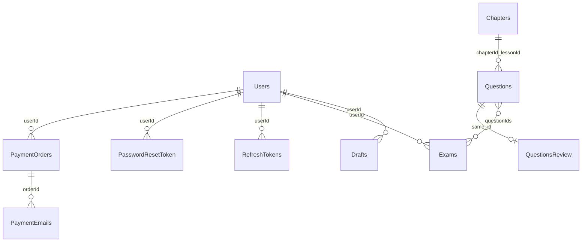

# MongoDB schema và trạng thái dữ liệu

## Auth OTP/Google — 2026-11-13

- Users dùng trực tiếp email đã trim/lowercase (không biến đổi dấu chấm/+ Gmail), unique index đầy đủ trên email. Không dùng field dẫn xuất cho kiểm tra tồn tại. googleSubject nullable có unique partial index, chỉ kiểm tra liên kết sau lookup email. loginMethod LOCAL/GOOGLE/MIXED: LOCAL có mật khẩu liên kết Google thành MIXED; Google-only giữ GOOGLE. Link cập nhật riêng googleSubject/loginMethod/updatedAt và kiểm role/active, giữ password/PLUS.
- AuthVerifications: _id=SHA256(token ngẫu nhiên256bit), purpose LOCAL_REGISTER/GOOGLE_REGISTER/GOOGLE_LINK/HANDOFF, email/username, hashedPassword BCrypt khi LOCAL, googleSubject/userId khi cần, bindingHash cho handoff, authoritativeEmail, otpHash HMAC-SHA256, attempts/ready/consumed/revision, expiresAt/otpExpiresAt/resendAt. Không lưu OTP/mật khẩu thô/JWT. TTL expiresAt0s; OTP5 phút/session30 phút/handoff60 giây.
- AuthOtpRateLimits: _id=email đã chuẩn hóa, sentAt danh sách thời điểm gửi trong rolling60 phút, resendAt, revision, expiresAt. CAS reserve trước gửi, max5/60 phút và120 giây; TTL expiresAt0s sau2 giờ không hoạt động. Gửi lỗi vẫn tính quota/cooldown.

[AuthIndexConfig](../backend/src/main/java/com/wedu/exam_creation/auth/infrastructure/AuthIndexConfig.java) fail startup nếu email chưa chuẩn hóa hoặc còn index dẫn xuất cũ; lỗi hướng dẫn bật --auth.migration.enabled=true. [AuthMigrationUsecase](../backend/src/main/java/com/wedu/exam_creation/auth/usecase/AuthMigrationUsecase.java) preflight toàn bộ dữ liệu trước ghi; repository partial update Users.email/loginMethod và unset emailKey, drop legacy index, giữ opaque _id/password/role/PLUS. Không thêm collection/schema đích. AuthMigrationRunner mặc định tắt và chạy trước index guard khi bật; AuthIndexConfig tạo/reuse unique/TTL indexes sau đó. Thay hoàn toàn script JS đã xóa. [Validation](auth-java-migration-implementation-report.md).

## Refund persistence — 2026-11-09

New collections (no TTL/backfill):

| Collection / document | Fields and invariants |
| --- | --- |
| RefundRequests / RefundDocument | Random32hex _id, orderId/userId/email snapshot, idempotencyKey, amount VND, status, reason, policyVersion, eligibility, decisionReason, adminId, createdAt/updatedAt/submittedAt/lastCheckedAt, requestId, providerCode/providerStatus/refundTransactionNo, pollingStopped, revision, history[{at,status,actor,reason}], checks[{key,result,reason}]. |
| RefundAccounts / RefundAccountDocument | _id=userId string, trackedSince, lastAiUsedAt, activeAi attempt IDs, holds refund IDs, revision. CAS/transactions serialize per-user operations. Unknown attempts are not expired as unused. |
| RefundAiReceipts / RefundAiReceiptDocument | _id=attempt UUID, userId string, createdAt; inserted in the exam transaction only for persisted AI-generated questions. |

Refund status: PENDING_REVIEW / NEEDS_VERIFICATION / PROCESSING / REFUNDED / REJECTED / FAILED / CANCELLED. Eligibility: ELIGIBLE / INELIGIBLE / UNKNOWN; check result: PASSED / FAILED / UNKNOWN. Unique (userId,idempotencyKey) prevents request replay. Active/previously refunded order checks are serialized through RefundAccounts; they are not inferred from accountType.

PaymentOrders adds nullable plusStartsAt/refundedAt and booleans refundTracked/plusLegacyProtected (legacy absent=false). Newly verified grants record their entitlement interval and AI-evidence coverage. Future intervals may shift after a preceding refund; original status remains SUCCEEDED. Legacy start may be derived from plusExpiresAt-durationDays only when consistent. A purchase originating from indefinite legacy PLUS is flagged to prevent automatic destructive revocation. PaymentEmails adds nullable refundId/message; deterministic refund event IDs share its existing send lease/retry indexes. Users keeps its existing accountType/plusExpiresAt shape; mutations update only entitlement fields.

[RefundIndexConfig](../backend/src/main/java/com/wedu/exam_creation/payment/infrastructure/RefundIndexConfig.java) ensures RefundRequests unique(userId,idempotencyKey), (orderId,status), (createdAt DESC,_id DESC), (userId,createdAt DESC), (status,lastCheckedAt); RefundAccounts(trackedSince); RefundAiReceipts(userId,createdAt DESC); PaymentOrders(userId,paidAt). Indexes initialize independently of refund enablement and create the collections before transaction use. Replica-set transaction support and index permissions are required; deployed presence remains unverified.

> Cập nhật mới nhất 2026-11-10: phần hoàn tiền ở đầu tài liệu đối chiếu code đã merge vào main `cbcb49a`. Các snapshot theo ngày bên dưới giữ giá trị lịch sử, không chứng nhận deploy hoặc validation mới.

## Snapshot hiện tại — 2026-11-06

Đối chiếu source/config tại commit `abcde6e`. Có **12 root collections** theo @Document hiện tại; embedded models không được tính thành collection riêng. PaymentOrders/PaymentEmails và Users.plusExpiresAt đã có code. Đây là schema suy ra từ source; chưa truy vấn database hoặc xác minh index/topology thật.

Các mục có ngày cũ là bằng chứng lịch sử của từng lần triển khai; khi mâu thuẫn, dùng snapshot hiện tại và source được dẫn. Không suy ra production hoặc kiểm thử end-to-end đã đạt từ việc có code.

## Quản lý usage/budget AI — 2026-11-01

Hai collection mới, không backfill hoặc đổi Questions/QuestionsReview:

| Collection/document | Fields |
| --- | --- |
| `AiUsage` / AiUsageDocument | `_id:String` UUID nội bộ; createdAt:Instant (lúc bắt đầu); model:String; outcome:String = STARTED/RECEIVED/FAILED; usageKnown:boolean; inputTokens/outputTokens/cacheHitTokens/totalTokens:long; estimatedCostUsd:BigDecimal; pricingVersion:String; inputCacheHitPrice/inputCacheMissPrice/outputPrice:BigDecimal (USD/triệu token) |
| `AiBudget` / AiBudgetDocument | `_id:String` cố định global; revision:long; monthlyBudgetUsd:BigDecimal nullable; monthlyTokenQuota:Long nullable |

Tất cả BigDecimal trên document có `@Field(targetType=DECIMAL128)`. AiUsage có hai index non-unique `{createdAt:1}` và `{model:1,createdAt:1}`, được repository tạo lazy bằng createIndex khi đọc/ghi usage lần đầu; không phụ thuộc auto-index-creation. Không TTL hoặc cleanup lịch sử. `_id` mặc định Mongo giữ tính unique của cấu hình global. Sửa budget dùng findAndModify với `_id + revision`, tăng revision; khởi tạo dùng insert chống hai admin tạo đồng thời.

STARTED/FAILED hoặc response không có usage hợp lệ là usageKnown=false; số 0 trong trường cộng dồn không đại diện hóa đơn thực bằng 0. Aggregation trả unknownUsageRequests riêng. RECEIVED chỉ nghĩa nhận được JSON provider, không chứng minh nội dung câu hỏi hợp lệ/lưu thành công. Chi phí ghi độc lập transaction câu hỏi (NOT_SUPPORTED) nên không rollback theo Questions. Hạn mức tháng tính từ query theo Asia/Ho_Chi_Minh, không có collection bộ đếm/reset/reservation.

Bằng chứng: [documents](../backend/src/main/java/com/wedu/exam_creation/ai/infrastructure/document/AiUsageDocument.java), [budget](../backend/src/main/java/com/wedu/exam_creation/ai/infrastructure/document/AiBudgetDocument.java), [repository](../backend/src/main/java/com/wedu/exam_creation/ai/infrastructure/repository/AiUsageRepositoryImpl.java). Schema/index production và durability trên Mongo thật chưa xác nhận.

## Kiểm duyệt câu hỏi AI — 2026-10-31

QuestionsReview thêm `regenerationCount:int` (0–4 khi còn chờ) và `revision:long` (tăng sau append/edit snapshot). Field thiếu được đọc là 0; query revision 0 chấp nhận missing/null. Không thêm collection/index/migration. Khi thao tác với câu PENDING_REVIEW thiếu review, khởi tạo bằng upsert setOnInsert trong transaction; không backfill hàng loạt.

regeneratedQuestions chứa tối đa 4 snapshot theo thứ tự sinh thành công; ID snapshot giữ ID gốc, metadata lấy từ câu gốc, status PENDING_REVIEW, có createdAt/updatedAt và content/options với model riêng. Editor chỉ thay snapshot cuối, giữ createdAt và bộ đếm, tăng revision. Nội dung Questions không thay trước khi duyệt, nhưng updatedAt tăng khi append/edit snapshot để chặn request cũ.

Duyệt cập nhật Questions.status=APPROVED và lấy question/options của snapshot cuối nếu có, giữ _id/metadata/createdAt. Từ chối lần 5 giữ nội dung gốc, status=NEEDS_CONSIDERATION. Cả hai xóa QuestionsReview trong cùng Mongo transaction. Số lượt 5 chỉ còn trong response vì review đã xóa; không có lịch sử/audit sau kết thúc. AI lỗi không ghi. Placeholder/S3 keys giữ nguyên, không persist presigned URL. Không lọc status khi sinh đề.

[Review model](../backend/src/main/java/com/wedu/exam_creation/questionReview/infrastructure/document/QuestionReviewDocument.java), [review adapter](../backend/src/main/java/com/wedu/exam_creation/questionReview/infrastructure/repository/QuestionReviewRepositoryImpl.java), [question adapter](../backend/src/main/java/com/wedu/exam_creation/question/infrastructure/repository/QuestionRepositoryImpl.java).

## Cập nhật nội dung câu hỏi chờ duyệt — 2026-10-29

Không thêm collection/field/index. Questions.question và options vẫn ContentDocument `{template, variables:{math,image}}`; updatedAt đã có. AI sinh mô tả text trong image map; khi moderator lưu với file hợp lệ, chỉ sau conditional update thành công mô tả được thay bằng `media/questions/{questionId}/<uuid>.<extension>`. Ảnh cũ theo media/ convention giữ nguyên nếu không thay. Không lưu mô tả vào field riêng hoặc presigned URL. Variables không còn tham chiếu bị loại khỏi content khi lưu. Status vẫn PENDING_REVIEW, không thay metadata/createdAt, không append QuestionsReview snapshot. Query guard `_id + status + updatedAt` chống editor cũ ghi đè; timestamp mới ít nhất tăng 1 ms khi cần. Các đề có thể dùng lại media nên không xóa object cũ.

Bằng chứng: [repository updatePendingContent](../backend/src/main/java/com/wedu/exam_creation/question/infrastructure/repository/QuestionRepositoryImpl.java), [edit usecase](../backend/src/main/java/com/wedu/exam_creation/moderator/usecase/EditPendingQuestionUsecase.java), [reference convention](../backend/src/main/java/com/wedu/exam_creation/moderator/usecase/QuestionImageReference.java). GET pending bổ sung updatedAt là DTO HTTP, không thêm field DB.

## Collection câu hỏi cần duyệt — 2026-10-26

Collection QuestionsReview (tên hiện tại trong @Document của source) dùng QuestionReviewDocument: id:String @Id trùng Questions._id; regeneratedQuestions:List<RegeneratedQuestionDocument> embedded, mặc định []. Domain QuestionReviewEntity dùng List<RegeneratedQuestionEntity>. Snapshot có đầy đủ fields như Question: id, chapterId, lessonId, exerciseType, difficultyLevel, learningOutcomes, questionType, status, question, options, createdAt, updatedAt. Content/Variables có model riêng trong questionReview, giữ template và math/image maps cùng placeholders. chapterId/lessonId snapshot giữ FieldType.OBJECT_ID, id giữ @Id; snapshot không @Document, @Indexed hoặc @CompoundIndex. Không collection/index mới cho snapshot. QuestionReviewMapper tự map nội bộ; không phụ thuộc model question.

Bằng chứng: [QuestionReviewDocument](../backend/src/main/java/com/wedu/exam_creation/questionReview/infrastructure/document/QuestionReviewDocument.java), [RegeneratedQuestionEntity](../backend/src/main/java/com/wedu/exam_creation/questionReview/domain/entity/RegeneratedQuestionEntity.java), [RegeneratedQuestionDocument](../backend/src/main/java/com/wedu/exam_creation/questionReview/infrastructure/document/RegeneratedQuestionDocument.java), [QuestionReviewMapper](../backend/src/main/java/com/wedu/exam_creation/questionReview/infrastructure/mapper/QuestionReviewMapper.java).

## Trạng thái câu hỏi — 2026-10-26

Collection Questions thêm status: String, không default/index. Parse = APPROVED; AI = PENDING_REVIEW. QuestionMapper ánh xạ QuestionEntity ↔ QuestionDocument; legacy thiếu field đọc là null (chưa xác định), không migration/backfill.

Bằng chứng: [QuestionService](../backend/src/main/java/com/wedu/exam_creation/question/usecase/QuestionService.java), [QuestionDocument](../backend/src/main/java/com/wedu/exam_creation/question/infrastructure/document/QuestionDocument.java).

## Kiểm duyệt tệp không đổi schema — 2026-10-25

Không thêm collection/field/index, submission, audit hoặc receipt S3. Sự hiện diện trong `question-files/` là hàng chờ; approve import rồi xóa, reject xóa rồi email. Không lưu APPROVED/REJECTED/reviewer/reason/email delivery. DTO approve {questionIds,fileDeleted,message} và reject {key,reason} là contract HTTP, không phải document. cleanupKeys frontend là bộ nhớ phiên, không bảo đảm idempotency xuyên moderator/restart/mất phản hồi. [ModeratorUsecase](../backend/src/main/java/com/wedu/exam_creation/moderator/usecase/ModeratorUsecase.java), [API](api-reference.md#duyệttừ-chối-tệp--2026-10-25).

## Phạm vi

Đây là schema suy ra trực tiếp từ **document classes và repository**, đối chiếu 2026-11-06, không phải dump database. Không kết nối MongoDB; dữ liệu/index/version thực đều **unknown**. Collection nằm trong [application.yml](../backend/src/main/resources/application.yml) với database cấu hình `test001`, MongoDB SRV. Repository dùng MongoTemplate; [MongoConfig](../backend/src/main/java/com/wedu/exam_creation/config/MongoConfig.java) tạo MongoTransactionManager.

Các mục field phía dưới trích tên/Java type, không đưa dữ liệu người dùng/secrets. `@Id String id` là property Java ánh xạ `_id`; annotations ObjectId được ghi rõ, không mặc định mọi String BSON đều lưu như nhau. `List<>`/Map là embedded data, không phải collection riêng nếu không có `@Document`.

## Collections và references

| Collection | Root document / domain | Embedded / reference / invariant |
| --- | --- | --- |
| Users | [UserDocument](../backend/src/main/java/com/wedu/exam_creation/user/infrastructure/document/UserDocument.java) / UserEntity | Avatar local là S3 key; Google service ghi URL. role, loginMethod, accountType là String, isActive là Boolean. |
| Chapters | [ChapterDocument](../backend/src/main/java/com/wedu/exam_creation/chapter/infrastructure/document/ChapterDocument.java) / ChapterEntity | Embedded lessons[].bankStats[]; lesson ID do code tạo. Field timestamp thực tên `createAt`, không đổi thành createdAt trong docs. |
| Questions | [QuestionDocument](../backend/src/main/java/com/wedu/exam_creation/question/infrastructure/document/QuestionDocument.java) / QuestionEntity | chapterId→Chapters, lessonId→embedded lesson. Hai ref annotated OBJECT_ID. Embedded content/options/variables. |
| QuestionsReview | [QuestionReviewDocument](../backend/src/main/java/com/wedu/exam_creation/questionReview/infrastructure/document/QuestionReviewDocument.java) | _id→Questions._id (cùng kiểu @Id String); regeneratedQuestions[] embedded RegeneratedQuestionDocument thuộc questionReview, ban đầu rỗng. Chỉ tạo khi insert PENDING_REVIEW. |
| Drafts | [DraftDocument](../backend/src/main/java/com/wedu/exam_creation/draft/infrastructure/document/DraftDocument.java) / DraftEntity | userId annotated OBJECT_ID→Users; chapter/lesson snapshot chứa ID, name và matrix/details. |
| Exams | [ExamDocument](../backend/src/main/java/com/wedu/exam_creation/exam/infrastructure/document/ExamDocument.java) / ExamEntity | userId→Users; chapter/lesson snapshot; groups questionType/difficultyLevel/questionIds. questionIds annotated OBJECT_ID→Questions. |
| RefreshTokens | [RefreshTokenDocument](../backend/src/main/java/com/wedu/exam_creation/refreshToken/infrastructure/document/RefreshTokenDocument.java) / RefreshTokenEntity | jti, userId OBJECT_ID→Users, expiresAt/issuedAt. Lưu metadata, không lưu refresh JWT plaintext trong document. |
| PasswordResetToken | [PasswordResetTokenDocument](../backend/src/main/java/com/wedu/exam_creation/passwordResetToken/infrastructure/document/PasswordResetTokenDocument.java) / PasswordResetTokenEntity | tokenHash SHA-256, userId String không annotation OBJECT_ID, expiryDate, used, createdAt. |
| AiBudget | [AiBudgetDocument](../backend/src/main/java/com/wedu/exam_creation/ai/infrastructure/document/AiBudgetDocument.java) | Cấu hình giới hạn chung, revision chống ghi đè. |
| AiUsage | [AiUsageDocument](../backend/src/main/java/com/wedu/exam_creation/ai/infrastructure/document/AiUsageDocument.java) | Usage/outcome/giá snapshot và chi phí ước tính. |
| PaymentOrders | [PaymentOrderDocument](../backend/src/main/java/com/wedu/exam_creation/payment/infrastructure/document/PaymentOrderDocument.java) | Random64hex _id, hash idempotency riêng; userId→Users; expiry5 phút cho đơn mới, không TTL xóa. |
| PaymentEmails | [PaymentEmailDocument](../backend/src/main/java/com/wedu/exam_creation/payment/infrastructure/document/PaymentEmailDocument.java) | Outbox _id=orderId:status, lease/retry và sentAt. |

Đây là quan hệ logic do code sử dụng, **không phải foreign-key constraint MongoDB**. Lesson/matrix/content là embedded. Exam snapshot không copy body câu hỏi; đọc đề phụ thuộc Questions còn tồn tại. Bằng chứng: [ExamUsecase.getExamById/generateExam](../backend/src/main/java/com/wedu/exam_creation/exam/usecase/ExamUsecase.java), [ExamResponseDTOMapper](../backend/src/main/java/com/wedu/exam_creation/exam/dto/mapper/ExamResponseDTOMapper.java).

## Trạng thái và transitions được xác minh

| Dữ liệu | Giá trị/transitions có trong source | Điều không được suy ra |
| --- | --- | --- |
| User local | create active=true,ROLE_TEACHER,FREE; admin lock/unlock/đổi role | plusExpiresAt nullable; role/password dùng partial update để không ghi đè entitlement đã thanh toán. |
| User Google | loginMethod GOOGLE, ROLE_USER, active=true; picture URL | accountType/timestamps không set tại create branch; không mặc định FREE. |
| accountType | FREE/PLUS là String; DTO trả quyền hiệu lực theo plusExpiresAt | Không phải Spring role. PLUS/null giữ legacy; PLUS hết hạn đọc thành FREE; grant chỉ sau kết quả payment hợp lệ. |
| Reset token | used=false → used=true; expiryDate now+15m; request mới xóa token cũ của user | Cleanup TTL không phải logic expiry; chưa atomic consume. |
| Refresh metadata | save khi local auth → delete lúc logout/thu hồi | Không thấy refresh rotation hoặc access blacklist. |
| Draft/exam | Suy ra giai đoạn từ cấu trúc chapters/matrix/details hoặc document có tồn tại | Không có status DRAFT/FINAL/PUBLISHED/PROCESSING. |
| File/câu hỏi/AI | File là S3 object; Question.status: parse APPROVED, AI PENDING_REVIEW | Có trạng thái ban đầu APPROVED/PENDING_REVIEW; chưa có REJECTED, source, reviewer, submittedBy hoặc review audit. |
| Giao dịch tiền | PaymentOrders/PaymentEmails; PENDING/SUCCEEDED/FAILED/CANCELLED/EXPIRED | Mongo transaction + revision và outbox; không có refund/invoice thuế. |

Bằng chứng: [UserUsecase](../backend/src/main/java/com/wedu/exam_creation/user/usecase/UserUsecase.java), [CustomOAuth2UserService](../backend/src/main/java/com/wedu/exam_creation/security/infrastructure/service/CustomOAuth2UserService.java), [PasswordResetTokenUsecase](../backend/src/main/java/com/wedu/exam_creation/passwordResetToken/usecase/PasswordResetTokenUsecase.java), [AuthUsecase](../backend/src/main/java/com/wedu/exam_creation/auth/usecase/AuthUsecase.java), [QuestionService](../backend/src/main/java/com/wedu/exam_creation/question/usecase/QuestionService.java), document catalogue bên dưới.

## Index, timestamps và consistency

- QuestionDocument: unique compound `chapter_lesson_idx={chapterId:1,lessonId:1}`; individual `@Indexed` trên exerciseType/difficultyLevel/questionType. Nếu unique index thực tồn tại sẽ giới hạn một câu mỗi chương/bài; chưa truy DB để xác minh.
- PasswordResetTokenDocument: `@Indexed(expireAfter="10m")` trên expiryDate. Use case đã đặt expiryDate now+15m; TTL cleanup nếu index tồn tại xảy ra sau expiryDate, không làm token hợp lệ thêm 10 phút.
- Chưa thấy bật auto-index-creation hoặc migration/index provisioning trong source; không khẳng định annotation đã được apply. Chưa thấy unique annotation cho Users.email; duplicate check trong service không thay unique constraint khi race.
- Timestamp là Instant; repository question/chapter/user update đặt thủ công trong nhiều nhánh. Có CreatedDate/LastModifiedDate annotations nhưng chưa thấy EnableMongoAuditing; không giả định timestamps luôn được tự cập nhật ở mọi save.
- Draft/exam read/delete có owner query; bulk matrix write chỉ lọc draft ID, use case nạp owner trước. ID conversions dùng cả String/ObjectId, cần theo repository thật khi sửa.
- Chapter merge theo name toàn cục, lesson merge theo name trong chapter; bankStats merge bằng metadata. AI insert chưa gọi chapter service để cập nhật bankStats.
- User delete chỉ xóa user/refresh metadata trong luồng hiện tại; chưa cascade draft/exam/reset/media. Exam delete không xóa ngân hàng câu.

Bằng chứng: [QuestionDocument](../backend/src/main/java/com/wedu/exam_creation/question/infrastructure/document/QuestionDocument.java), [PasswordResetTokenDocument](../backend/src/main/java/com/wedu/exam_creation/passwordResetToken/infrastructure/document/PasswordResetTokenDocument.java), [UserRepositoryImpl](../backend/src/main/java/com/wedu/exam_creation/user/infrastructure/repository/UserRepositoryImpl.java), [DraftRepositoryImpl](../backend/src/main/java/com/wedu/exam_creation/draft/infrastructure/repository/DraftRepositoryImpl.java), [ChapterRepositoryImpl](../backend/src/main/java/com/wedu/exam_creation/chapter/infrastructure/repository/ChapterRepositoryImpl.java), [QuestionRepositoryImpl](../backend/src/main/java/com/wedu/exam_creation/question/infrastructure/repository/QuestionRepositoryImpl.java), [ExamRepositoryImpl](../backend/src/main/java/com/wedu/exam_creation/exam/infrastructure/repository/ExamRepositoryImpl.java).

## S3 object data ngoài MongoDB

`avatars/`, `question-files/<subject>/`, `media/` là prefixes, không phải moderation states. Avatar UUID key; DOCX key `question-files/<subject>/<email>-<PascalCaseName>.docx`, bỏ path gốc và dấu tiếng Việt trong filename. Cùng bộ giá trị có thể ghi đè cùng key; subject được ghép trực tiếp. Chưa thấy S3 object metadata về reviewer/status/owner; email trong key không thay record submission.

`S3ObjectInfo` là **response DTO, không phải Mongo document**: key:String, fileName:String, size:Long, lastModified:Instant, presignedUrl:String. Frontend [QuestionFileEntity](../frontend/domain/entities/questionFile.entity.ts) dùng size:number và lastModified:string. `listQuestionFiles` duyệt continuation token, bỏ folder-marker, sinh signed download URL 60 phút với Content-Disposition attachment; URL chỉ sinh lúc đọc, không lưu vào Mongo.

Nguồn: [S3ObjectInfo](../backend/src/main/java/com/wedu/exam_creation/storage/dto/response/S3ObjectInfo.java), [S3Service](../backend/src/main/java/com/wedu/exam_creation/storage/service/S3Service.java), [StorageController](../backend/src/main/java/com/wedu/exam_creation/storage/controller/StorageController.java), [ModeratorUsecase](../backend/src/main/java/com/wedu/exam_creation/moderator/usecase/ModeratorUsecase.java). Không thêm collection/schema review trong source hiện tại. Image variable maps và exporter vẫn dùng key→presigned URL→Base64 như trước.
## Danh mục field của toàn bộ document classes

Các bảng sau được đối chiếu trực tiếp declaration trong source; default initializer chỉ là khởi tạo Java, không phải database validator/default. Entity/DTO catalogue và API nằm trong [module-map.md](module-map.md).

### BankStatDocument — embedded class

Source: [BankStatDocument](../backend/src/main/java/com/wedu/exam_creation/chapter/infrastructure/document/BankStatDocument.java).

| Field | Java type | Mapping annotation |
| --- | --- | --- |
| `exerciseType` | `String` | — |
| `difficultyLevels` | `List<String>` | `@Builder.Default` |
| `learningOutcomes` | `List<String>` | `@Builder.Default` |
| `questionType` | `String` | — |
| `count` | `Integer` | `@Builder.Default` |

### ChapterDocument — collection `Chapters`

Source: [ChapterDocument](../backend/src/main/java/com/wedu/exam_creation/chapter/infrastructure/document/ChapterDocument.java).

| Field | Java type | Mapping annotation |
| --- | --- | --- |
| `id` | `String` | `@Id` |
| `subject` | `String` | — |
| `name` | `String` | — |
| `lessons` | `List<LessonDataDocument>` | `@Builder.Default` |
| `createAt` | `Instant` | `@CreatedDate` |
| `updatedAt` | `Instant` | `@LastModifiedDate` |

### LessonDataDocument — embedded class

Source: [LessonDataDocument](../backend/src/main/java/com/wedu/exam_creation/chapter/infrastructure/document/LessonDataDocument.java).

| Field | Java type | Mapping annotation |
| --- | --- | --- |
| `id` | `String` | — |
| `name` | `String` | — |
| `bankStats` | `List<BankStatDocument>` | `@Builder.Default` |

### ChapterDraftDocument — embedded class

Source: [ChapterDraftDocument](../backend/src/main/java/com/wedu/exam_creation/draft/infrastructure/document/ChapterDraftDocument.java).

| Field | Java type | Mapping annotation |
| --- | --- | --- |
| `id` | `String` | `@Builder.Default` |
| `name` | `String` | — |
| `lessons` | `List<LessonDraftDocument>` | `@Builder.Default` |

### DraftDocument — collection `Drafts`

Source: [DraftDocument](../backend/src/main/java/com/wedu/exam_creation/draft/infrastructure/document/DraftDocument.java).

| Field | Java type | Mapping annotation |
| --- | --- | --- |
| `id` | `String` | `@Id` |
| `userId` | `String` | `@Field(targetType = FieldType.OBJECT_ID)` |
| `examName` | `String` | — |
| `questionsCount` | `Integer` | — |
| `questionTypes` | `List<String>` | `@Builder.Default` |
| `chapters` | `List<ChapterDraftDocument>` | `@Builder.Default` |
| `createdAt` | `Instant` | `@CreatedDate` |
| `updatedAt` | `Instant` | `@LastModifiedDate` |

### LessonDraftDocument — embedded class

Source: [LessonDraftDocument](../backend/src/main/java/com/wedu/exam_creation/draft/infrastructure/document/LessonDraftDocument.java).

| Field | Java type | Mapping annotation |
| --- | --- | --- |
| `id` | `String` | `@Builder.Default` |
| `name` | `String` | — |
| `matrix` | `List<MatrixItemDocument>` | `@Builder.Default` |
| `matrixDetails` | `List<MatrixDetailItemDocument>` | `@Builder.Default` |

### MatrixDetailItemDocument — embedded class

Source: [MatrixDetailItemDocument](../backend/src/main/java/com/wedu/exam_creation/draft/infrastructure/document/MatrixDetailItemDocument.java).

| Field | Java type | Mapping annotation |
| --- | --- | --- |
| `exerciseType` | `String` | — |
| `difficultyLevel` | `String` | — |
| `learningOutcome` | `String` | — |
| `questionType` | `String` | — |
| `selectedCount` | `Integer` | — |

### MatrixItemDocument — embedded class

Source: [MatrixItemDocument](../backend/src/main/java/com/wedu/exam_creation/draft/infrastructure/document/MatrixItemDocument.java).

| Field | Java type | Mapping annotation |
| --- | --- | --- |
| `questionType` | `String` | — |
| `difficultyLevel` | `String` | — |
| `selectedCount` | `Integer` | — |

### ChapterExamDocument — embedded class

Source: [ChapterExamDocument](../backend/src/main/java/com/wedu/exam_creation/exam/infrastructure/document/ChapterExamDocument.java).

| Field | Java type | Mapping annotation |
| --- | --- | --- |
| `id` | `String` | `@Builder.Default` |
| `name` | `String` | — |
| `lessons` | `List<LessonExamDocument>` | `@Builder.Default` |

### ExamDocument — collection `Exams`

Source: [ExamDocument](../backend/src/main/java/com/wedu/exam_creation/exam/infrastructure/document/ExamDocument.java).

| Field | Java type | Mapping annotation |
| --- | --- | --- |
| `id` | `String` | `@Id` |
| `userId` | `String` | `@Field(targetType = FieldType.OBJECT_ID)` |
| `name` | `String` | — |
| `chapters` | `List<ChapterExamDocument>` | — |
| `questions` | `List<QuestionExamDocument>` | — |
| `createdAt` | `Instant` | `@CreatedDate` |
| `updatedAt` | `Instant` | `@LastModifiedDate` |

### ExamMatrixDetailItemDocument — embedded class

Source: [ExamMatrixDetailItemDocument](../backend/src/main/java/com/wedu/exam_creation/exam/infrastructure/document/ExamMatrixDetailItemDocument.java).

| Field | Java type | Mapping annotation |
| --- | --- | --- |
| `exerciseType` | `String` | — |
| `difficultyLevel` | `String` | — |
| `learningOutcome` | `String` | — |
| `questionType` | `String` | — |
| `selectedCount` | `Integer` | — |

### ExamMatrixItemDocument — embedded class

Source: [ExamMatrixItemDocument](../backend/src/main/java/com/wedu/exam_creation/exam/infrastructure/document/ExamMatrixItemDocument.java).

| Field | Java type | Mapping annotation |
| --- | --- | --- |
| `questionType` | `String` | — |
| `difficultyLevel` | `String` | — |
| `selectedCount` | `Integer` | — |

### LessonExamDocument — embedded class

Source: [LessonExamDocument](../backend/src/main/java/com/wedu/exam_creation/exam/infrastructure/document/LessonExamDocument.java).

| Field | Java type | Mapping annotation |
| --- | --- | --- |
| `id` | `String` | `@Builder.Default` |
| `name` | `String` | — |
| `matrix` | `List<ExamMatrixItemDocument>` | `@Builder.Default` |
| `matrixDetails` | `List<ExamMatrixDetailItemDocument>` | `@Builder.Default` |

### QuestionExamDocument — embedded class

Source: [QuestionExamDocument](../backend/src/main/java/com/wedu/exam_creation/exam/infrastructure/document/QuestionExamDocument.java).

| Field | Java type | Mapping annotation |
| --- | --- | --- |
| `questionType` | `String` | — |
| `difficultyLevel` | `String` | — |
| `questionIds` | `List<String>` | `@Field(targetType = FieldType.OBJECT_ID)` |

### PasswordResetTokenDocument — collection `PasswordResetToken`

Source: [PasswordResetTokenDocument](../backend/src/main/java/com/wedu/exam_creation/passwordResetToken/infrastructure/document/PasswordResetTokenDocument.java).

| Field | Java type | Mapping annotation |
| --- | --- | --- |
| `id` | `String` | `@Id` |
| `tokenHash` | `String` | — |
| `userId` | `String` | — |
| `expiryDate` | `Instant` | `@Indexed(expireAfter = "10m")` |
| `used` | `boolean` | — |
| `createdAt` | `Instant` | — |

### ContentDocument — embedded class

Source: [ContentDocument](../backend/src/main/java/com/wedu/exam_creation/question/infrastructure/document/ContentDocument.java).

| Field | Java type | Mapping annotation |
| --- | --- | --- |
| `template` | `String` | — |
| `variables` | `VariablesDocument` | `@Builder.Default` |

### QuestionDocument — collection `Questions`

Source: [QuestionDocument](../backend/src/main/java/com/wedu/exam_creation/question/infrastructure/document/QuestionDocument.java).

| Field | Java type | Mapping annotation |
| --- | --- | --- |
| `id` | `String` | `@Id` |
| `chapterId` | `String` | `@Field(targetType = FieldType.OBJECT_ID)` |
| `lessonId` | `String` | `@Field(targetType = FieldType.OBJECT_ID)` |
| `exerciseType` | `String` | `@Indexed` |
| `difficultyLevel` | `String` | `@Indexed` |
| `learningOutcomes` | `List<String>` | `@Builder.Default` |
| `questionType` | `String` | `@Indexed` |
| `status` | `String` | APPROVED/PENDING_REVIEW; legacy null |
| `question` | `ContentDocument` | — |
| `options` | `List<ContentDocument>` | `@Builder.Default` |
| `createdAt` | `Instant` | `@CreatedDate` |
| `updatedAt` | `Instant` | `@LastModifiedDate` |

### VariablesDocument — embedded class

Source: [VariablesDocument](../backend/src/main/java/com/wedu/exam_creation/question/infrastructure/document/VariablesDocument.java).

| Field | Java type | Mapping annotation |
| --- | --- | --- |
| `math` | `Map<String, String>` | `@Builder.Default` |
| `image` | `Map<String, String>` | `@Builder.Default` |

### RefreshTokenDocument — collection `RefreshTokens`

Source: [RefreshTokenDocument](../backend/src/main/java/com/wedu/exam_creation/refreshToken/infrastructure/document/RefreshTokenDocument.java).

| Field | Java type | Mapping annotation |
| --- | --- | --- |
| `id` | `String` | `@Id` |
| `jti` | `String` | — |
| `userId` | `String` | `@Field(targetType = FieldType.OBJECT_ID)` |
| `expiresAt` | `Instant` | — |
| `issuedAt` | `Instant` | — |

### UserDocument — collection `Users`

Source: [UserDocument](../backend/src/main/java/com/wedu/exam_creation/user/infrastructure/document/UserDocument.java).

| Field | Java type | Mapping annotation |
| --- | --- | --- |
| `id` | `String` | `@Id` |
| `email` | `String` | — |
| `hashedPassword` | `String` | — |
| `username` | `String` | — |
| `role` | `String` | — |
| `loginMethod` | `String` | — |
| `avatarUrl` | `String` | — |
| `isActive` | `Boolean` | — |
| `accountType` | `String` | — |
| `createdAt` | `Instant` | `@CreatedDate` |
| `updatedAt` | `Instant` | `@LastModifiedDate` |
| `plusExpiresAt` | `Instant` | Nullable; hạn PLUS, null giữ legacy |

## Backend payment persistence — 2026-11-05

Users adds nullable Instant plusExpiresAt. Legacy PLUS/null remains effective; expired PLUS is read as FREE. PaymentOrders stores random64hex _id, idempotencyKeyHash=SHA256(userId+":"+key), userId/email snapshot, amount=20000,durationDays=30,status,createdAt,expiresAt,paidAt,plusExpiresAt,transactionNo,responseCode,transactionStatus,clientIp,manualReview,revision,lastVerifiedAt. Legacy orders use deterministic _id; request lookup falls back to that _id. No migration/backfill.

PaymentEmails stores _id=orderId:status,orderId,email,status,plusExpiresAt,manualReview,attempts,nextAttemptAt,sentAt,leaseToken. Indexes: PaymentOrders(idempotencyKeyHash) unique+sparse, PaymentOrders(status,expiresAt), PaymentEmails(sentAt,nextAttemptAt); no TTL deletion. Mongo transaction and conditional revision atomically save order, entitlement and outbox. Late verified success may promote EXPIRED/FAILED/CANCELLED to SUCCEEDED; SUCCEEDED cannot be downgraded. Deleting a record removes its reconciliation/idempotency evidence. [Documents](../backend/src/main/java/com/wedu/exam_creation/payment/infrastructure/document/PaymentOrderDocument.java), [repository](../backend/src/main/java/com/wedu/exam_creation/payment/infrastructure/repository/PaymentRepositoryImpl.java).

## ADMIN transaction lookup indexes — 2026-11-08

No collection or field additions. PaymentOrders remains the local source; status is the stored value and email is its purchase snapshot. Lookup does not write lastVerifiedAt or provider results.

[AdminTransactionIndexConfig.indexes](../backend/src/main/java/com/wedu/exam_creation/payment/infrastructure/AdminTransactionIndexConfig.java) creates non-unique indexes (createdAt DESC,_id DESC), (status ASC,createdAt DESC,_id DESC) and (transactionNo ASC) at ApplicationReadyEvent, independent of payment.vnpay.enabled. Existing indexes remain. Requires Mongo index-creation permission; no backfill/TTL. Production index presence/performance has not been verified. Literal contains-email matching may still scan.
