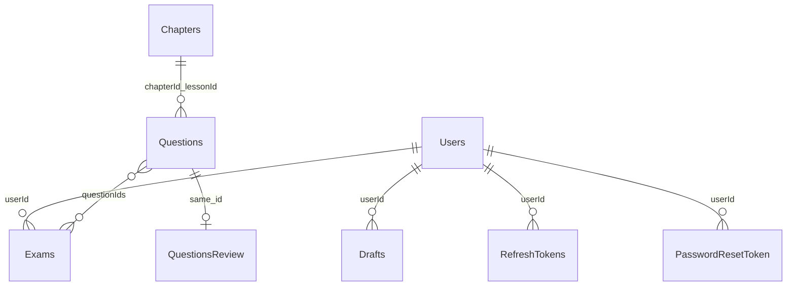

# MongoDB schema và trạng thái dữ liệu

## Collection câu hỏi cần duyệt — 2026-10-26

Collection QuestionsReview (tên hiện tại trong @Document của source) dùng QuestionReviewDocument: id:String @Id trùng Questions._id; regeneratedQuestions:List<RegeneratedQuestionDocument> embedded, mặc định []. Domain QuestionReviewEntity dùng List<RegeneratedQuestionEntity>. Snapshot có đầy đủ fields như Question: id, chapterId, lessonId, exerciseType, difficultyLevel, learningOutcomes, questionType, status, question, options, createdAt, updatedAt. Content/Variables có model riêng trong questionReview, giữ template và math/image maps cùng placeholders. chapterId/lessonId snapshot giữ FieldType.OBJECT_ID, id giữ @Id; snapshot không @Document, @Indexed hoặc @CompoundIndex. Không collection/index mới cho snapshot. QuestionReviewMapper tự map nội bộ; không phụ thuộc model question.

Bằng chứng: [QuestionReviewDocument](../backend/src/main/java/com/wedu/exam_creation/questionReview/infrastructure/document/QuestionReviewDocument.java), [RegeneratedQuestionEntity](../backend/src/main/java/com/wedu/exam_creation/questionReview/domain/entity/RegeneratedQuestionEntity.java), [RegeneratedQuestionDocument](../backend/src/main/java/com/wedu/exam_creation/questionReview/infrastructure/document/RegeneratedQuestionDocument.java), [QuestionReviewMapper](../backend/src/main/java/com/wedu/exam_creation/questionReview/infrastructure/mapper/QuestionReviewMapper.java).

## Trạng thái câu hỏi — 2026-10-26

Collection Questions thêm status: String, không default/index. Parse = APPROVED; AI = PENDING_REVIEW. QuestionMapper ánh xạ QuestionEntity ↔ QuestionDocument; legacy thiếu field đọc là null (chưa xác định), không migration/backfill.

Bằng chứng: [QuestionService](../backend/src/main/java/com/wedu/exam_creation/question/usecase/QuestionService.java), [QuestionDocument](../backend/src/main/java/com/wedu/exam_creation/question/infrastructure/document/QuestionDocument.java).

## Kiểm duyệt tệp không đổi schema — 2026-10-25

Không thêm collection/field/index, submission, audit hoặc receipt S3. Sự hiện diện trong `question-files/` là hàng chờ; approve import rồi xóa, reject xóa rồi email. Không lưu APPROVED/REJECTED/reviewer/reason/email delivery. DTO approve {questionIds,fileDeleted,message} và reject {key,reason} là contract HTTP, không phải document. cleanupKeys frontend là bộ nhớ phiên, không bảo đảm idempotency xuyên moderator/restart/mất phản hồi. [ModeratorUsecase](../backend/src/main/java/com/wedu/exam_creation/moderator/usecase/ModeratorUsecase.java), [API](api-reference.md#duyệttừ-chối-tệp--2026-10-25).

## Phạm vi

Đây là schema suy ra trực tiếp từ **document classes và repository**, snapshot 2026-10-24, không phải dump database. Không kết nối MongoDB; dữ liệu/index/version thực đều **unknown**. Collection nằm trong [application.yml](../backend/src/main/resources/application.yml) với database cấu hình `test001`, MongoDB SRV. Repository dùng MongoTemplate; [MongoConfig](../backend/src/main/java/com/wedu/exam_creation/config/MongoConfig.java) tạo MongoTransactionManager.

Các mục field phía dưới trích tên/Java type, không đưa dữ liệu người dùng/secrets. `@Id String id` là property Java ánh xạ `_id`; annotations ObjectId được ghi rõ, không mặc định mọi String BSON đều lưu như nhau. `List<>`/Map là embedded data, không phải collection riêng nếu không có `@Document`.

## Collections và references

| Collection | Root document / domain | Embedded / reference / invariant |
| --- | --- | --- |
| Users | [UserDocument](../backend/src/main/java/com/wedu/exam_creation/user/infrastructure/document/UserDocument.java) / UserEntity | Avatar local là S3 key; Google service ghi URL. role, loginMethod, accountType là String, isActive là Boolean. |
| Chapters | [ChapterDocument](../backend/src/main/java/com/wedu/exam_creation/chapter/infrastructure/document/ChapterDocument.java) / ChapterEntity | Embedded lessons[].bankStats[]; lesson ID do code tạo. Field timestamp thực tên `createAt`, không đổi thành createdAt trong docs. |
| Questions | [QuestionDocument](../backend/src/main/java/com/wedu/exam_creation/question/infrastructure/document/QuestionDocument.java) / QuestionEntity | chapterId→Chapters, lessonId→embedded lesson. Hai ref annotated OBJECT_ID. Embedded content/options/variables. |
| QuestionsReview | [QuestionReviewDocument](../backend/src/main/java/com/wedu/exam_creation/questionReview/infrastructure/document/QuestionReviewDocument.java) | _id→Questions._id (cùng kiểu @Id String); regeneratedQuestions[] embedded RegeneratedQuestionDocument thuộc questionReview, ban đầu rỗng. Chỉ tạo khi insert PENDING_REVIEW. |
| Drafts | [DraftDocument](../backend/src/main/java/com/wedu/exam_creation/draft/infrastructure/document/DraftDocument.java) / DraftEntity | userId annotated OBJECT_ID→Users; chapter/lesson snapshot chứa ID, name và matrix/details. |
| Exams | [ExamDocument](../backend/src/main/java/com/wedu/exam_creation/exam/infrastructure/document/ExamDocument.java) / ExamEntity | userId→Users; chapter/lesson snapshot; groups questionType/difficultyLevel/questionIds. questionIds annotated OBJECT_ID→Questions. |
| RefreshTokens | [RefreshTokenDocument](../backend/src/main/java/com/wedu/exam_creation/refreshToken/infrastructure/document/RefreshTokenDocument.java) / RefreshTokenEntity | jti, userId OBJECT_ID→Users, expiresAt/issuedAt. Lưu metadata, không lưu refresh JWT plaintext trong document. |
| PasswordResetToken | [PasswordResetTokenDocument](../backend/src/main/java/com/wedu/exam_creation/passwordResetToken/infrastructure/document/PasswordResetTokenDocument.java) / PasswordResetTokenEntity | tokenHash SHA-256, userId String không annotation OBJECT_ID, expiryDate, used, createdAt. |

Đây là quan hệ logic do code sử dụng, **không phải foreign-key constraint MongoDB**. Lesson/matrix/content là embedded. Exam snapshot không copy body câu hỏi; đọc đề phụ thuộc Questions còn tồn tại. Bằng chứng: [ExamUsecase.getExamById/generateExam](../backend/src/main/java/com/wedu/exam_creation/exam/usecase/ExamUsecase.java), [ExamResponseDTOMapper](../backend/src/main/java/com/wedu/exam_creation/exam/dto/mapper/ExamResponseDTOMapper.java).

## Trạng thái và transitions được xác minh

| Dữ liệu | Giá trị/transitions có trong source | Điều không được suy ra |
| --- | --- | --- |
| User local | create active=true, ROLE_TEACHER, FREE; admin lock false/unlock true; role change | Chưa có membership expiry/quota hoặc payment upgrade state. |
| User Google | loginMethod GOOGLE, ROLE_USER, active=true; picture URL | accountType/timestamps không set tại create branch; không mặc định FREE. |
| accountType | FREE mặc định local; PLUS được kiểm tra ở sinh đề | Không phải enum hoặc billing lifecycle. |
| Reset token | used=false → used=true; expiryDate now+15m; request mới xóa token cũ của user | Cleanup TTL không phải logic expiry; chưa atomic consume. |
| Refresh metadata | save khi local auth → delete lúc logout/thu hồi | Không thấy refresh rotation hoặc access blacklist. |
| Draft/exam | Suy ra giai đoạn từ cấu trúc chapters/matrix/details hoặc document có tồn tại | Không có status DRAFT/FINAL/PUBLISHED/PROCESSING. |
| File/câu hỏi/AI | File là S3 object; Question.status: parse APPROVED, AI PENDING_REVIEW | Có trạng thái ban đầu APPROVED/PENDING_REVIEW; chưa có REJECTED, source, reviewer, submittedBy hoặc review audit. |
| Giao dịch tiền | Không thấy collection/model payment/transaction | Không tự tạo pending/paid/refund hoặc suy ra PLUS đã được mua. |

Bằng chứng: [UserUsecase](../backend/src/main/java/com/wedu/exam_creation/user/usecase/UserUsecase.java), [CustomOAuth2UserService](../backend/src/main/java/com/wedu/exam_creation/security/infrastructure/service/CustomOAuth2UserService.java), [PasswordResetTokenUsecase](../backend/src/main/java/com/wedu/exam_creation/passwordResetToken/usecase/PasswordResetTokenUsecase.java), [AuthUsecase](../backend/src/main/java/com/wedu/exam_creation/auth/usecase/AuthUsecase.java), [QuestionService](../backend/src/main/java/com/wedu/exam_creation/question/usecase/QuestionService.java), document catalogue bên dưới.

## Index, timestamps và consistency

- QuestionDocument: unique compound `chapter_lesson_idx={chapterId:1,lessonId:1}`; individual `@Indexed` trên exerciseType/difficultyLevel/questionType. Nếu unique index thực tồn tại sẽ giới hạn một câu mỗi chương/bài; chưa truy DB để xác minh.
- PasswordResetTokenDocument: `@Indexed(expireAfter="10m")` trên expiryDate. Use case đã đặt expiryDate now+15m; TTL cleanup nếu index tồn tại xảy ra sau expiryDate, không làm token hợp lệ thêm 10 phút.
- Chưa thấy bật auto-index-creation hoặc migration/index provisioning trong source; không khẳng định annotation đã được apply. Chưa thấy unique annotation cho Users.email; duplicate check trong service không thay unique constraint khi race.
- Timestamp là Instant; repository question/chapter/user update đặt thủ công trong nhiều nhánh. Có CreatedDate/LastModifiedDate annotations nhưng chưa thấy EnableMongoAuditing; không giả định timestamps luôn được tự cập nhật ở mọi save.
- Draft/exam read/delete có owner query; bulk matrix write chỉ lọc draft ID, use case nạp owner trước. ID conversions dùng cả String/ObjectId, cần theo repository thật khi sửa.
- Chapter merge theo name toàn cục, lesson merge theo name trong chapter; bankStats merge bằng metadata. AI insert chưa gọi chapter service để cập nhật bankStats.
- User delete chỉ xóa user/refresh metadata trong luồng hiện tại; chưa cascade draft/exam/reset/media. Exam delete không xóa ngân hàng câu.

Bằng chứng: [QuestionDocument](../backend/src/main/java/com/wedu/exam_creation/question/infrastructure/document/QuestionDocument.java), [PasswordResetTokenDocument](../backend/src/main/java/com/wedu/exam_creation/passwordResetToken/infrastructure/document/PasswordResetTokenDocument.java), [UserRepositoryImpl](../backend/src/main/java/com/wedu/exam_creation/user/infrastructure/repository/UserRepositoryImpl.java), [DraftRepositoryImpl](../backend/src/main/java/com/wedu/exam_creation/draft/infrastructure/repository/DraftRepositoryImpl.java), [ChapterRepositoryImpl](../backend/src/main/java/com/wedu/exam_creation/chapter/infrastructure/repository/ChapterRepositoryImpl.java), [QuestionRepositoryImpl](../backend/src/main/java/com/wedu/exam_creation/question/infrastructure/repository/QuestionRepositoryImpl.java), [ExamRepositoryImpl](../backend/src/main/java/com/wedu/exam_creation/exam/infrastructure/repository/ExamRepositoryImpl.java).

## S3 object data ngoài MongoDB

`avatars/`, `question-files/<subject>/`, `media/` là prefixes, không phải moderation states. Avatar UUID key; DOCX key `question-files/<subject>/<email>-<PascalCaseName>.docx`, bỏ path gốc và dấu tiếng Việt trong filename. Cùng bộ giá trị có thể ghi đè cùng key; subject được ghép trực tiếp. Chưa thấy S3 object metadata về reviewer/status/owner; email trong key không thay record submission.

`S3ObjectInfo` là **response DTO, không phải Mongo document**: key:String, fileName:String, size:Long, lastModified:Instant, presignedUrl:String. Frontend [QuestionFileEntity](../frontend/domain/entities/questionFile.entity.ts) dùng size:number và lastModified:string. `listQuestionFiles` duyệt continuation token, bỏ folder-marker, sinh signed download URL 60 phút với Content-Disposition attachment; URL chỉ sinh lúc đọc, không lưu vào Mongo.

Nguồn: [S3ObjectInfo](../backend/src/main/java/com/wedu/exam_creation/storage/dto/response/S3ObjectInfo.java), [S3Service](../backend/src/main/java/com/wedu/exam_creation/storage/service/S3Service.java), [StorageController](../backend/src/main/java/com/wedu/exam_creation/storage/controller/StorageController.java), [ModeratorUsecase](../backend/src/main/java/com/wedu/exam_creation/moderator/usecase/ModeratorUsecase.java). Không thêm collection/schema review trong source hiện tại. Image variable maps và exporter vẫn dùng key→presigned URL→Base64 như trước.
## Danh mục field của toàn bộ document classes

Các bảng sau được đối chiếu trực tiếp declaration trong source; default initializer chỉ là khởi tạo Java, không phải database validator/default. Entity/DTO catalogue và API nằm trong [module-map.md](module-map.md).

### BankStatDocument — embedded class

Source: [BankStatDocument](../backend/src/main/java/com/wedu/exam_creation/chapter/infrastructure/document/BankStatDocument.java).

| Field | Java type | Mapping annotation |
| --- | --- | --- |
| `exerciseType` | `String` | — |
| `difficultyLevels` | `List<String>` | `@Builder.Default` |
| `learningOutcomes` | `List<String>` | `@Builder.Default` |
| `questionType` | `String` | — |
| `count` | `Integer` | `@Builder.Default` |

### ChapterDocument — collection `Chapters`

Source: [ChapterDocument](../backend/src/main/java/com/wedu/exam_creation/chapter/infrastructure/document/ChapterDocument.java).

| Field | Java type | Mapping annotation |
| --- | --- | --- |
| `id` | `String` | `@Id` |
| `subject` | `String` | — |
| `name` | `String` | — |
| `lessons` | `List<LessonDataDocument>` | `@Builder.Default` |
| `createAt` | `Instant` | `@CreatedDate` |
| `updatedAt` | `Instant` | `@LastModifiedDate` |

### LessonDataDocument — embedded class

Source: [LessonDataDocument](../backend/src/main/java/com/wedu/exam_creation/chapter/infrastructure/document/LessonDataDocument.java).

| Field | Java type | Mapping annotation |
| --- | --- | --- |
| `id` | `String` | — |
| `name` | `String` | — |
| `bankStats` | `List<BankStatDocument>` | `@Builder.Default` |

### ChapterDraftDocument — embedded class

Source: [ChapterDraftDocument](../backend/src/main/java/com/wedu/exam_creation/draft/infrastructure/document/ChapterDraftDocument.java).

| Field | Java type | Mapping annotation |
| --- | --- | --- |
| `id` | `String` | `@Builder.Default` |
| `name` | `String` | — |
| `lessons` | `List<LessonDraftDocument>` | `@Builder.Default` |

### DraftDocument — collection `Drafts`

Source: [DraftDocument](../backend/src/main/java/com/wedu/exam_creation/draft/infrastructure/document/DraftDocument.java).

| Field | Java type | Mapping annotation |
| --- | --- | --- |
| `id` | `String` | `@Id` |
| `userId` | `String` | `@Field(targetType = FieldType.OBJECT_ID)` |
| `examName` | `String` | — |
| `questionsCount` | `Integer` | — |
| `questionTypes` | `List<String>` | `@Builder.Default` |
| `chapters` | `List<ChapterDraftDocument>` | `@Builder.Default` |
| `createdAt` | `Instant` | `@CreatedDate` |
| `updatedAt` | `Instant` | `@LastModifiedDate` |

### LessonDraftDocument — embedded class

Source: [LessonDraftDocument](../backend/src/main/java/com/wedu/exam_creation/draft/infrastructure/document/LessonDraftDocument.java).

| Field | Java type | Mapping annotation |
| --- | --- | --- |
| `id` | `String` | `@Builder.Default` |
| `name` | `String` | — |
| `matrix` | `List<MatrixItemDocument>` | `@Builder.Default` |
| `matrixDetails` | `List<MatrixDetailItemDocument>` | `@Builder.Default` |

### MatrixDetailItemDocument — embedded class

Source: [MatrixDetailItemDocument](../backend/src/main/java/com/wedu/exam_creation/draft/infrastructure/document/MatrixDetailItemDocument.java).

| Field | Java type | Mapping annotation |
| --- | --- | --- |
| `exerciseType` | `String` | — |
| `difficultyLevel` | `String` | — |
| `learningOutcome` | `String` | — |
| `questionType` | `String` | — |
| `selectedCount` | `Integer` | — |

### MatrixItemDocument — embedded class

Source: [MatrixItemDocument](../backend/src/main/java/com/wedu/exam_creation/draft/infrastructure/document/MatrixItemDocument.java).

| Field | Java type | Mapping annotation |
| --- | --- | --- |
| `questionType` | `String` | — |
| `difficultyLevel` | `String` | — |
| `selectedCount` | `Integer` | — |

### ChapterExamDocument — embedded class

Source: [ChapterExamDocument](../backend/src/main/java/com/wedu/exam_creation/exam/infrastructure/document/ChapterExamDocument.java).

| Field | Java type | Mapping annotation |
| --- | --- | --- |
| `id` | `String` | `@Builder.Default` |
| `name` | `String` | — |
| `lessons` | `List<LessonExamDocument>` | `@Builder.Default` |

### ExamDocument — collection `Exams`

Source: [ExamDocument](../backend/src/main/java/com/wedu/exam_creation/exam/infrastructure/document/ExamDocument.java).

| Field | Java type | Mapping annotation |
| --- | --- | --- |
| `id` | `String` | `@Id` |
| `userId` | `String` | `@Field(targetType = FieldType.OBJECT_ID)` |
| `name` | `String` | — |
| `chapters` | `List<ChapterExamDocument>` | — |
| `questions` | `List<QuestionExamDocument>` | — |
| `createdAt` | `Instant` | `@CreatedDate` |
| `updatedAt` | `Instant` | `@LastModifiedDate` |

### ExamMatrixDetailItemDocument — embedded class

Source: [ExamMatrixDetailItemDocument](../backend/src/main/java/com/wedu/exam_creation/exam/infrastructure/document/ExamMatrixDetailItemDocument.java).

| Field | Java type | Mapping annotation |
| --- | --- | --- |
| `exerciseType` | `String` | — |
| `difficultyLevel` | `String` | — |
| `learningOutcome` | `String` | — |
| `questionType` | `String` | — |
| `selectedCount` | `Integer` | — |

### ExamMatrixItemDocument — embedded class

Source: [ExamMatrixItemDocument](../backend/src/main/java/com/wedu/exam_creation/exam/infrastructure/document/ExamMatrixItemDocument.java).

| Field | Java type | Mapping annotation |
| --- | --- | --- |
| `questionType` | `String` | — |
| `difficultyLevel` | `String` | — |
| `selectedCount` | `Integer` | — |

### LessonExamDocument — embedded class

Source: [LessonExamDocument](../backend/src/main/java/com/wedu/exam_creation/exam/infrastructure/document/LessonExamDocument.java).

| Field | Java type | Mapping annotation |
| --- | --- | --- |
| `id` | `String` | `@Builder.Default` |
| `name` | `String` | — |
| `matrix` | `List<ExamMatrixItemDocument>` | `@Builder.Default` |
| `matrixDetails` | `List<ExamMatrixDetailItemDocument>` | `@Builder.Default` |

### QuestionExamDocument — embedded class

Source: [QuestionExamDocument](../backend/src/main/java/com/wedu/exam_creation/exam/infrastructure/document/QuestionExamDocument.java).

| Field | Java type | Mapping annotation |
| --- | --- | --- |
| `questionType` | `String` | — |
| `difficultyLevel` | `String` | — |
| `questionIds` | `List<String>` | `@Field(targetType = FieldType.OBJECT_ID)` |

### PasswordResetTokenDocument — collection `PasswordResetToken`

Source: [PasswordResetTokenDocument](../backend/src/main/java/com/wedu/exam_creation/passwordResetToken/infrastructure/document/PasswordResetTokenDocument.java).

| Field | Java type | Mapping annotation |
| --- | --- | --- |
| `id` | `String` | `@Id` |
| `tokenHash` | `String` | — |
| `userId` | `String` | — |
| `expiryDate` | `Instant` | `@Indexed(expireAfter = "10m")` |
| `used` | `boolean` | — |
| `createdAt` | `Instant` | — |

### ContentDocument — embedded class

Source: [ContentDocument](../backend/src/main/java/com/wedu/exam_creation/question/infrastructure/document/ContentDocument.java).

| Field | Java type | Mapping annotation |
| --- | --- | --- |
| `template` | `String` | — |
| `variables` | `VariablesDocument` | `@Builder.Default` |

### QuestionDocument — collection `Questions`

Source: [QuestionDocument](../backend/src/main/java/com/wedu/exam_creation/question/infrastructure/document/QuestionDocument.java).

| Field | Java type | Mapping annotation |
| --- | --- | --- |
| `id` | `String` | `@Id` |
| `chapterId` | `String` | `@Field(targetType = FieldType.OBJECT_ID)` |
| `lessonId` | `String` | `@Field(targetType = FieldType.OBJECT_ID)` |
| `exerciseType` | `String` | `@Indexed` |
| `difficultyLevel` | `String` | `@Indexed` |
| `learningOutcomes` | `List<String>` | `@Builder.Default` |
| `questionType` | `String` | `@Indexed` |
| `status` | `String` | APPROVED/PENDING_REVIEW; legacy null |
| `question` | `ContentDocument` | — |
| `options` | `List<ContentDocument>` | `@Builder.Default` |
| `createdAt` | `Instant` | `@CreatedDate` |
| `updatedAt` | `Instant` | `@LastModifiedDate` |

### VariablesDocument — embedded class

Source: [VariablesDocument](../backend/src/main/java/com/wedu/exam_creation/question/infrastructure/document/VariablesDocument.java).

| Field | Java type | Mapping annotation |
| --- | --- | --- |
| `math` | `Map<String, String>` | `@Builder.Default` |
| `image` | `Map<String, String>` | `@Builder.Default` |

### RefreshTokenDocument — collection `RefreshTokens`

Source: [RefreshTokenDocument](../backend/src/main/java/com/wedu/exam_creation/refreshToken/infrastructure/document/RefreshTokenDocument.java).

| Field | Java type | Mapping annotation |
| --- | --- | --- |
| `id` | `String` | `@Id` |
| `jti` | `String` | — |
| `userId` | `String` | `@Field(targetType = FieldType.OBJECT_ID)` |
| `expiresAt` | `Instant` | — |
| `issuedAt` | `Instant` | — |

### UserDocument — collection `Users`

Source: [UserDocument](../backend/src/main/java/com/wedu/exam_creation/user/infrastructure/document/UserDocument.java).

| Field | Java type | Mapping annotation |
| --- | --- | --- |
| `id` | `String` | `@Id` |
| `email` | `String` | — |
| `hashedPassword` | `String` | — |
| `username` | `String` | — |
| `role` | `String` | — |
| `loginMethod` | `String` | — |
| `avatarUrl` | `String` | — |
| `isActive` | `Boolean` | — |
| `accountType` | `String` | — |
| `createdAt` | `Instant` | `@CreatedDate` |
| `updatedAt` | `Instant` | `@LastModifiedDate` |
